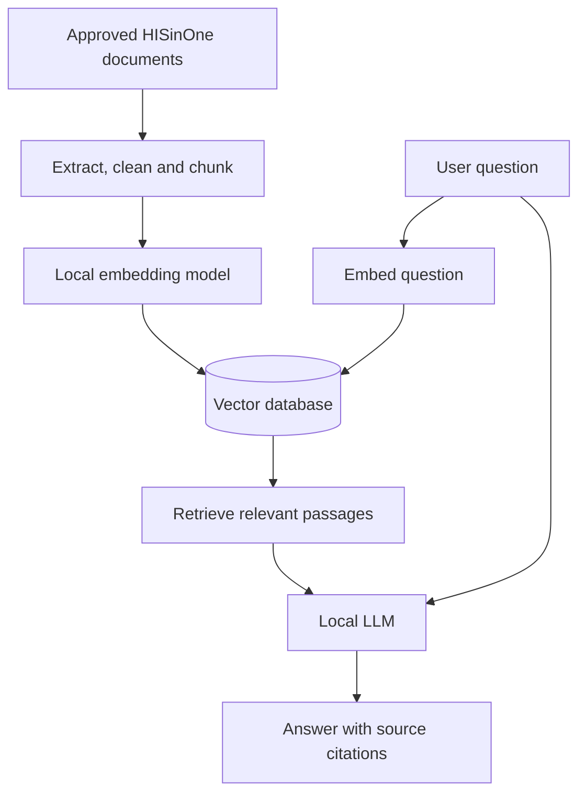

# KIWi — AI-Powered Knowledge Assistant for THWS CampusPortal

> **Project status:** Planning / early development  
> **Module:** MAI Project Module · Winter Semester 2026/27  
> **Institution:** Technical University of Applied Sciences Würzburg-Schweinfurt (THWS)  
> **Team:** 3 students

## Overview

**KIWi** (*KI-Wissensassistenz*) is a proposed, locally hosted AI knowledge assistant designed to help students and staff find information about the THWS CampusPortal (HISinOne).

The project uses **Retrieval-Augmented Generation (RAG)** to retrieve relevant passages from approved university documentation and generate clear, source-cited answers. Its architecture is intended to keep sensitive information within the university's infrastructure rather than sending it to external LLM APIs.

## Problem

CampusPortal workflows and documentation can be difficult to navigate. Information may be scattered across manuals, internal wikis, training materials, and process documents. KIWi aims to make that knowledge easier to access through natural-language questions.

## Planned Features

- **Natural-language Q&A:** Ask CampusPortal-related questions conversationally.
- **Document ingestion:** Process and index approved documentation.
- **Semantic retrieval:** Find relevant passages based on meaning, not just keywords.
- **Source citations:** Link answers to supporting documents.
- **Local LLM inference:** Run an open-weight model on university-controlled infrastructure.
- **Quality evaluation:** Assess answer accuracy, relevance, and hallucinations.
- **Containerized deployment:** Package the prototype for reproducibility.

## How It Works

1. Approved documents are collected, cleaned, and divided into searchable chunks.
2. A local embedding model converts chunks into vector representations.
3. The vectors and document metadata are stored in a vector database.
4. A user's question retrieves the most relevant chunks.
5. A locally hosted LLM generates an answer grounded in those chunks, including source references.

## Proposed Technology Stack

| Component | Candidate technologies |
| --- | --- |
| Language | Python |
| Local LLM inference | Ollama or vLLM |
| LLMs | Mistral, Llama, or Qwen |
| RAG orchestration | LangChain or LlamaIndex |
| Vector database | ChromaDB or pgvector |
| Interface | To be selected (e.g., Streamlit or a web frontend) |
| Deployment | Docker |

> The final stack will be selected after requirements analysis and consultation with the HISinOne team.

## 15-Week Development Roadmap

| Weeks | Focus | Expected outcome |
| --- | --- | --- |
| 1–2 | Requirements and knowledge audit | Requirements and source inventory |
| 2–3 | Architecture and stack selection | System design and poster plan |
| 3–4 | Local development environment | Local LLM and project skeleton |
| 4–7 | Document processing and ingestion | Indexed knowledge base |
| 6–8 | Embeddings and vector search | Semantic retrieval prototype |
| 8–11 | RAG pipeline, prompts and citations | Grounded question answering |
| 10–12 | Chat interface | End-to-end usable prototype |
| 12–14 | Evaluation and refinement | Accuracy, relevance and hallucination analysis |
| 14–15 | Packaging, paper and demo | Final deliverables |

*This schedule is a proposed plan; actual university milestone dates may differ.*

## Project Milestones

- **Poster session:** Requirements, knowledge audit, architecture, technology choices, and pipeline plan.
- **Paper:** RAG design, knowledge base implementation, and evaluation methodology/results.
- **Live demo:** Dockerized prototype answering representative anonymized CampusPortal questions, supported by evaluation results.

## Evaluation Plan

The prototype will be tested using a representative set of anonymized CampusPortal questions. Evaluation will consider:

- **Retrieval relevance:** Whether the retrieved passages contain useful evidence.
- **Answer accuracy:** Whether the generated response matches the documentation.
- **Citation correctness:** Whether cited passages support the claims made.
- **Hallucination rate:** Whether the assistant invents unsupported details.
- **Operational reproducibility:** Whether the system can be reliably deployed and tested.

## Privacy and Security

KIWi is designed for local deployment without external LLM API calls. Only approved documentation should be ingested. Any personal or sensitive records must be handled according to THWS requirements, applicable data-protection rules, and access permissions. Local hosting alone does **not** guarantee GDPR compliance.

## Getting Started

The project is currently in the planning stage. Installation commands, environment configuration, and run instructions will be added once the implementation and technology stack are finalized.

## Deliverables

- Dockerized working prototype and source repository
- Short technical paper
- Project poster
- Live demonstration
- Evaluation on representative anonymized queries

## Academic Context

**Supervisor:** Prof. Dr. Ivan P. Yamshchikov  
**Module:** MAI Project Module, WS 2026/27  
**Institution:** THWS

## License

License and repository visibility will be determined in accordance with project-team and university requirements. Do not publish internal university documents or credentials.
